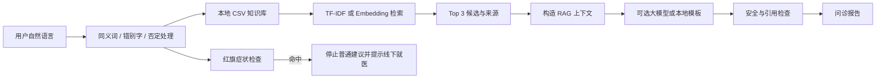

# TCM Consultation Agent

[](https://github.com/Hzwuu/tcm-consultation-rag/actions/workflows/ci.yml)


一个面向中医健康咨询场景的本地 RAG 原型。项目从 C/C++ 终端起步，扩展为包含结构化知识检索、来源展示、多轮问诊、安全分流和本地回退的 Python 应用。

> 仅用于学习、竞赛和健康咨询辅助。本项目不提供医学诊断或处方，不能替代医生。方剂名称只作为传统知识参考，不可自行服用。

## 项目概览

- 两代 C/C++ 终端：基础查询和输入容错。
- 两套运行知识库：15 条基础库和 20 条来源版库。
- 两种本地检索：TF-IDF 和哈希 Embedding。
- 两个运行入口：命令行和 Streamlit。
- 三种兼容模型：DeepSeek、Kimi 和通义千问。
- 安全机制：红旗优先、低置信度停止、输出过滤和本地模板回退。
- 完整性检查：SHA-256 本地哈希链原型，不是区块链。

## 解决的问题

1. 用户口语、同义词和错别字可能造成症状识别偏差。
2. 通用聊天模型回答缺少受控知识上下文和可核查依据。
3. 胸痛、呼吸困难等红旗症状必须在普通建议之前处理。
4. 检索证据不足时不应强行给出候选证型。
5. 本地问诊小结需要基础的改动检测机制。

## RAG 流程



大模型不负责知识检索、候选排序或红旗判断。

## 技术栈

```text
C/C++ STL            V1.0 / V1.2 终端
Python 3.10+         RAG、CLI、数据校验和测试
Streamlit            Web 演示
CSV                  结构化知识库与评测集
JSON                 向量快照、测试报告和哈希链
TF-IDF / 字符 n-gram 默认本地检索
BLAKE2b              离线哈希 Embedding
OpenAI 兼容接口       可选大模型生成
SHA-256              问诊小结完整性检查
```

核心逻辑使用 Python 标准库实现，没有依赖 LangChain、FAISS、Chroma 或神经重排序模型。

## 快速运行

### Python RAG 网页

```powershell
Set-Location .\rag
powershell -ExecutionPolicy Bypass -File .\环境准备.ps1
$env:PYTHONPATH = "src"
.\.venv\Scripts\python.exe -m streamlit run app\streamlit_app.py
```

浏览器访问 `http://localhost:8501`。

### Python 命令行

```powershell
Set-Location .\rag
$env:PYTHONPATH = "src"
.\.venv\Scripts\python.exe -m tcm_agent.cli --demo
.\.venv\Scripts\python.exe -m tcm_agent.cli --demo --kb-mode sourced
```

启用大模型前，复制 `rag/.env.example` 为 `rag/.env`，填写自己的密钥。不要提交 `.env`。

### C/C++ 终端

```powershell
Set-Location .\terminal
g++ -std=c++17 -O2 -finput-charset=UTF-8 -fexec-charset=UTF-8 "中医问诊智能体_V1.2_当前版_源码.cpp" -o "中医问诊智能体_V1.2_当前版.exe"
.\中医问诊智能体_V1.2_当前版.exe
```

终端程序必须和 `tcm_data.csv` 位于同一目录。

## 测试

```powershell
Set-Location .\rag
$env:PYTHONPATH = "src"
.\.venv\Scripts\python.exe tests\evaluate_system.py
.\.venv\Scripts\python.exe tests\evaluate_accuracy.py
.\.venv\Scripts\python.exe tests\evaluate_embedding_retrieval.py
.\.venv\Scripts\python.exe tests\evaluate_ledger.py
.\.venv\Scripts\python.exe tests\evaluate_llm_generation.py
```

测试结果来自自建工程测试集，不代表临床有效性或真实用户准确率。

当前综合测试结果：

- 明确目标检索 Top1 / Top3：16 / 16。
- 红旗识别 Precision / Recall：1.000 / 1.000。
- 低置信度识别：2 / 2。
- 结构化槽位：12 / 12。
- RAG 安全检查：5 / 5。

## 项目结构

```text
.
├── rag/
│   ├── app/             Streamlit 页面
│   ├── data/            知识库、评测集和向量快照
│   ├── docs/            架构、安全、来源和运行文档
│   ├── reports/         评测报告
│   ├── src/tcm_agent/   RAG、问诊、安全和模型调用
│   ├── tests/           可复跑测试和校验脚本
│   └── tools/           知识维护和向量索引工具
└── terminal/
    ├── tcm_data.csv
    ├── V1.0 源码
    └── V1.2 源码
```

## 开发职责

项目开发使用了生成式 AI 辅助代码和文档实现。提交者负责需求确定、技术方案选择、数据与安全边界、运行验证、问题反馈和最终版本整合，并能说明主要调用链和项目局限。

## 已知限制

- 知识库规模较小，来源版记录大多仍待中医专业审核。
- 默认 Embedding 是依赖无模型的哈希向量，不是 BGE 等神经语义模型。
- 没有使用外部向量数据库或神经重排序模型。
- 没有实现自动联网检索或来源内容实时核验。
- 否定识别只覆盖常见规则，不是完整中文语法分析。
- 哈希链只能发现普通改动，不提供不可篡改或外部公证。
- 项目定位为学习、竞赛和健康咨询辅助原型。

