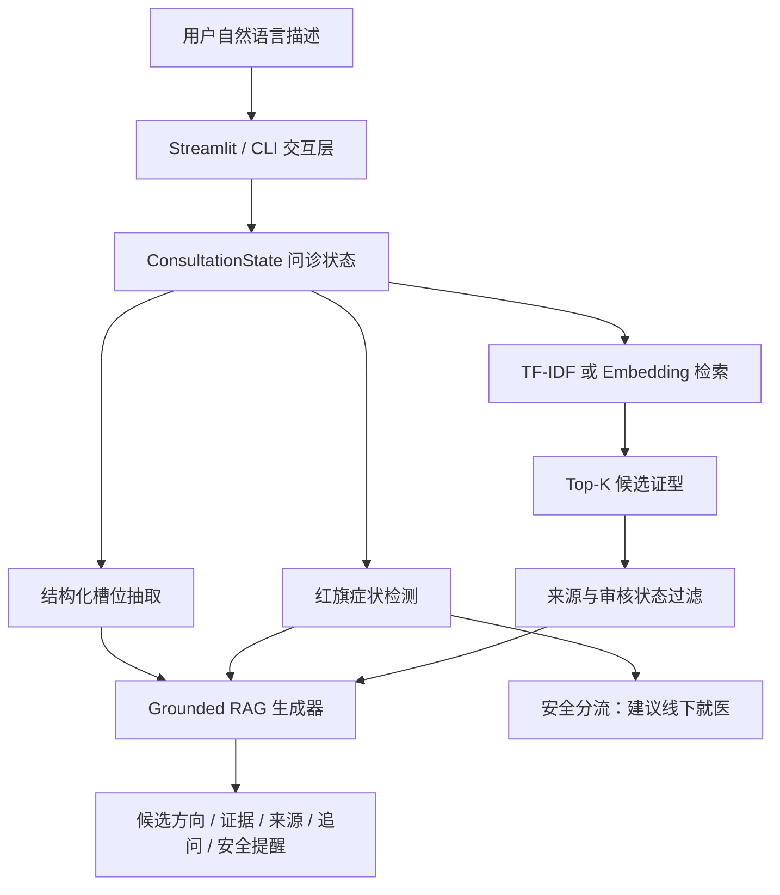

# 系统架构

## 总体流程

## 模块边界

| 模块 | 主要职责 |
| --- | --- |
| `data/` | 结构化知识库、来源字段、评估集和本地向量索引 |
| `src/tcm_agent/retrieval.py` | TF-IDF + 关键词混合检索 |
| `src/tcm_agent/embedding_retrieval.py` | 可插拔 Embedding provider 和向量检索 |
| `src/tcm_agent/structured_slots.py` | 寒热、出汗、口渴、二便、睡眠等槽位抽取 |
| `src/tcm_agent/safety.py` | 红旗症状和局部否定检测 |
| `src/tcm_agent/generation.py` | 来源约束、低置信度和红旗优先的 RAG 生成 |
| `app/streamlit_app.py` | 可交互 Web Demo |
| `tests/` | 检索、安全、槽位、向量索引和 RAG 评估 |

## 安全设计

1. 红旗症状优先于普通证候解释。
2. 低于置信度阈值时不强行选择候选证型。
3. 回答只使用检索上下文，不补充来源之外的医学事实。
4. 每个候选展示来源和审核状态。
5. 不输出确定性诊断、剂量或自行用药建议。
